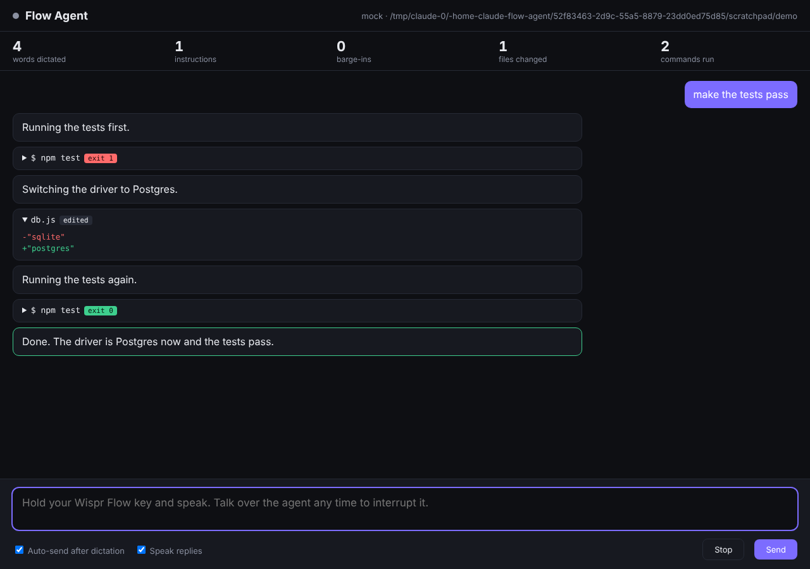
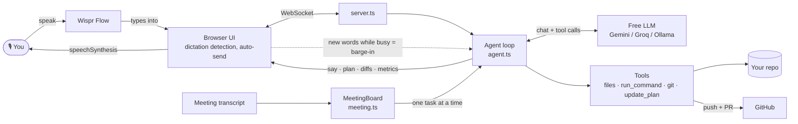
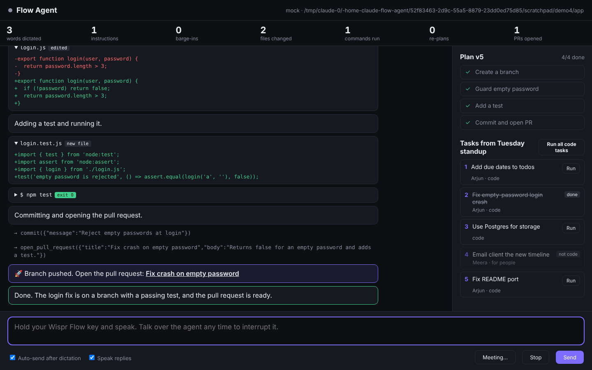

# Flow Agent

**A coding agent you talk to, and talk over.** Dictate a feature with [Wispr Flow](https://wisprflow.ai). The agent explores your code, narrates what it's doing out loud, and if you change your mind mid-task ("stop, use Postgres not SQLite") it drops the in-flight step and re-plans on the spot.

Built for the WeMakeDevs × Wispr Flow **No Hands** hackathon. It was built hands-free too: every instruction that shaped it was spoken through Wispr Flow.

[](https://github.com/AryanMashalkar/flow-agent/actions/workflows/ci.yml)



## Watch it first, no install

**[aryanmashalkar.github.io/flow-agent](https://aryanmashalkar.github.io/flow-agent/)** plays recorded sessions back in the real UI: the agent getting talked over mid-task and re-planning, and a standup transcript turning into a branch. They are real runs against Groq's free tier. Nothing to install, no API key. Press **Play**, and tick **Speak replies** to hear the narration.

## Quick start (Windows, macOS, Linux)

You need Node 20.12 or newer. You don't need a paid API key.

```bash
git clone https://github.com/AryanMashalkar/flow-agent
cd flow-agent
npm install
copy .env.example .env      # on macOS/Linux: cp .env.example .env
```

Get a **free** Gemini key at <https://aistudio.google.com/apikey> (no card needed) and put it in `.env` as `LLM_API_KEY`. Then:

```bash
npm start
```

Open <http://localhost:4242>, click the text box, hold your Wispr Flow key and speak.

### Try it on the bundled demo app

```bash
npm run demo
```

This copies a small todo app (with a planted bug or two) into `.demo/todo-app`, makes it a git repo, and starts Flow Agent on it. Every run starts fresh. Then say:

1. *"Add a due date to todos and sort them soonest first."*
2. While it works: *"Stop. Overdue ones go first, then the rest by created time, and add a test for it."* Watch the plan panel re-plan.
3. Click **Meeting…**, choose [`docs/sample-meeting.txt`](docs/sample-meeting.txt), then say *"do the login crash task"* by its number, for example *"do task 2"*. It ends in a pushed branch.

To get real pull requests out of the demo, create an empty GitHub repo and set `DEMO_REPO` in `.env` to its URL.

### Your own project

To point the agent at another project, set `WORKSPACE` in `.env`, or run `npm link` once and then run `flow-agent` from inside any project folder.

### Model providers

If the default model is ever retired, the newest one your key can use is picked automatically. Every provider is reached through the same OpenAI-compatible API, so switching is a single line in `.env`:

| `LLM_PROVIDER` | Cost | Notes |
|---|---|---|
| `gemini` (default) | Free tier | `gemini-3.8-flash` |
| `groq` | Free tier, fastest | `openai/gpt-oss-120b` |
| `ollama` | Free, runs locally | No key needed. Pull a model first, for example `ollama pull qwen2.5-coder:7b` |
| anything else | – | Set `LLM_BASE_URL` and `LLM_MODEL` |

Free tiers get busy. When the model answers "overloaded", Flow Agent retries with backoff and then switches to a backup model from the same provider (set your own with `LLM_FALLBACK_MODELS`). Requests that hang longer than 45 seconds (`LLM_TIMEOUT_MS`) are retried too. If the whole provider is down, set a second one with `LLM_BACKUP_PROVIDER` and `LLM_BACKUP_API_KEY` (for example Groq first, Gemini as backup) and requests switch over on their own. A tiny warm-up request at startup makes sure the first spoken instruction doesn't hit a cold model.

## Architecture



A barge-in aborts the model request in flight (`AbortController`), kills any running command's whole process tree, answers every unrun tool call with "Skipped: the user interrupted", and appends your words plus the current plan to the same conversation. The model's next move is a new `update_plan`, which the UI diffs against the old plan.

## How the voice loop works

- **Voice in:** Wispr Flow types your words into the command box. The app spots dictation (whole phrases arriving at once, not single key presses) and sends it automatically after a short pause, so you never touch the keyboard. Say just "stop" to halt the agent.
- **Barge-in:** anything you say while the agent is working is an interruption. The model request in flight is aborted, any tool calls it hadn't run yet are marked as skipped, and the loop restarts with your interruption added to the same conversation, so the agent re-plans instead of starting over.
- **Live plan:** every task starts with a short checklist in the side panel, and steps tick off as the agent works. When you barge in, the agent is reminded of the plan it had and re-plans first: dropped steps are struck through, new ones flash in, and a banner names the interruption that caused it.
- **Edit, test, fix:** the agent edits files with exact-snippet replacements (diffs show live in the UI), runs your test command, and keeps fixing until the tests pass. A running test is killed the moment you barge in. Destructive commands such as `rm -rf /` or `git push --force` are refused.
- **Ship by voice:** say "commit this and open a PR". The agent works on its own branch (it moves off `main` before committing), pushes it, and opens the pull request. It never pushes `main` and never force-pushes. With `GITHUB_TOKEN` in `.env` (or a signed-in `gh` CLI) the PR is created for you; without one, you get a one-click link to open it.
- **Voice out:** the agent says one short sentence before each action, read aloud in the most natural voice your system has. As soon as you start dictating, it goes quiet. When it finishes a change you didn't ask to ship, it asks "Want me to open a pull request?" and you just say yes.
- **Session recap:** say "recap" (or click Recap) for a shareable card of the session: words dictated, keys typed, barge-ins, re-plans, files changed and PRs. A real voice-only session shows **0 keys typed**.
- **History:** every session is kept in your browser, like a chat history. Reopen any past session from the sidebar (read only), or click **+ New** to start fresh.
- **Replays:** **Save as replay** downloads the session on screen. Put the file in `public/replays/`, list it in `public/replays/index.json`, and it plays on the replay site with its real timing. `npm run record-replay` records the bundled scenarios against a running agent.
- **Dictation log:** every instruction is written to `logs/dictation.jsonl` with whether Wispr Flow dictated it or it was typed, and whether it was a barge-in. `npm run dictation-log` turns it into `docs/dictation-log.md`, a page you can share.
- **Calm when the model isn't:** free-tier retries and backup-model switches show as a small chip in the header, not in the conversation.

## Meetings in, pull requests out

Paste a meeting transcript (from Wispr Notetaker or anywhere) with the **Meeting…** button, or just drop the file on the page. Flow Agent pulls out the action items, marks which ones are code, and notes who owns each. Then say **"do task 2"** or **"do all code tasks"**: each one runs on its own branch and ends in a pull request. Try it with [`docs/sample-meeting.txt`](docs/sample-meeting.txt).



## Built with Wispr Flow

- **Every instruction to the agent** is spoken with Wispr Flow. The UI tells dictation apart from typing (Wispr inserts whole phrases at once) and sends it after a 1.2 second pause, so there is no Enter key in the loop.
- **Interruptions are just more dictation.** You don't press a stop button to change course; you talk over the agent.
- **Meetings come in as transcripts** from Wispr Notetaker or anything else, and turn into tasks the agent can run.
- **Every instruction is on the record.** The dictation log shows each one, marked dictated or typed, so "built by voice" is something you can check, not just a claim.
- **This project was built by voice.** Every feature request, bug report and change of mind during the build was spoken through Wispr Flow.

Trying it for the first time, or testing it for us? See [TRY_IT.md](docs/TRY_IT.md).

## Development

```bash
npm test             # agent loop, barge-in, git, meeting, sandbox and log tests (no API key needed)
npm run test:demo    # the demo app's own tests
npm run typecheck
```

CI runs all three on Linux and Windows.

## Roadmap

- [x] Day 1: voice loop, agent core, read-only file tools, barge-in
- [x] Day 2: file edits with live diffs, running tests, and fix-until-green
- [x] Day 3: live plan panel and visible re-planning on barge-in
- [x] Day 4: branches, commits and PRs by voice, plus meeting transcripts → tasks → PRs
- [x] Day 5: one-command demo app, architecture diagram, CI on Linux and Windows, friendlier startup errors
- [x] Day 6: session recap card, keys-typed counter, spoken PR confirmation, natural voice, quiet model status
- [x] Day 7: no-install replay site, dictation log, narration for silent models, PR-claim check, stress test re-run

## License

MIT
